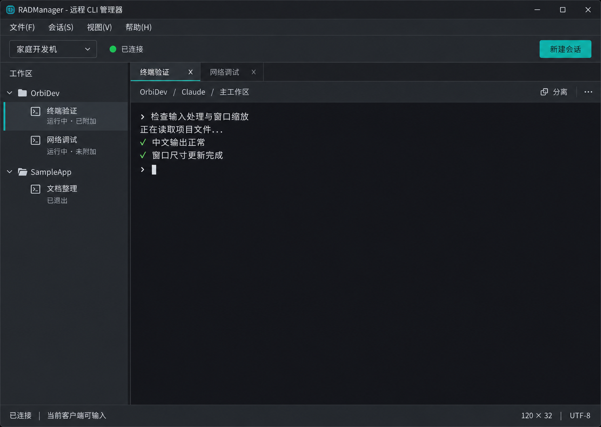

# RADManager UI 设计规格

> 版本：v1.0 ｜ 日期：2026-10-16
> 状态：用户已选定视觉方向；尚未实现或通过 Qt 运行验收。
> 基线：Qt 5.15.2 MSVC x64 + VS 2022 / v143 + C++20 + CMake。

## 1. 已选视觉方向

采用深灰底色、青绿色强调色的紧凑工程工具界面。首要任务是在公司客户端连接家庭 Agent，查找项目会话并操作远程终端。终端获得主要空间，导航、连接信息和会话操作保持清晰、克制。

这张图是生成的概念参考，不是运行截图。图中的输出、状态和尺寸均为示意；实现不得硬编码为真实结果。以本文的行为规则和可访问性要求为准，不复制图中不必要的渐变或像素误差。

## 2. 主窗口布局与操作

| 区域 | 内容与交互 | Qt 落点 |
|---|---|---|
| 标题栏 | 产品名及系统窗口操作，沿用系统拖动、缩放和贴靠行为 | QMainWindow 原生窗口 |
| 菜单栏 | 文件、会话、视图、帮助；仅显示已实现操作 | QMenuBar / QAction |
| 工具栏 | 家庭主机选择、连接状态；右侧突出“新建会话” | QToolBar、QComboBox、按钮 |
| 左侧工作区 | 按项目分组的会话树，可折叠；选中行用底色、标记和文字共同定位 | QSplitter + QTreeView |
| 中部标签 | 一个 Session ID 对应一个终端标签；重复打开定位已有标签 | QTabWidget |
| 会话上下文栏 | 当前项目、Provider、工作区；“分离”和更多菜单 | 普通布局与 QAction |
| 终端 | 真实 UTF-8/VT 输出、输入、选择、复制粘贴和尺寸同步 | QWebEngineView + xterm.js |
| 状态栏 | 主机连接、输入控制权、终端列行数、UTF-8 | QStatusBar |

- 初始布局参考 1440×1024，左栏约 240 个逻辑像素，可拖动调整和折叠。菜单、工具栏、标签和上下文栏保持紧凑，避免大标题挤占终端。
- 参考控件高度：菜单约 26、工具栏约 40、标签约 32、上下文栏约 30、状态栏约 24 个逻辑像素；最终由字体度量和 DPI 验证调整，不用固定高度裁切中文。
- 正文使用系统中文字体，初始约 14 个逻辑像素；次要文字约 12，终端约 15，并提供可读的中文回退字体。终端缩放必须重新计算实际列行数。
- 切换标签不等于分离；后台标签对应的远程进程继续运行。关闭标签提供“分离”“终止”“取消”，默认“分离”；“终止”必须明确确认且只作用于目标会话。
- 已分离但仍运行的会话留在树中，可重新附加到原 Session ID。分离不触发进程关闭，重新附加不启动第二个 CLI。
- 首版不显示尚未实现的 Git、构建、任务仪表盘或空白右侧面板。

### 终端快捷键与图片附件（2026-10-17 补充需求）

- 终端获得焦点时，Tab、Esc 和方向键透传给 CLI；`/` 命令菜单显示 CLI 原始输出，不由客户端复制命令列表。M4 验证键盘通路，M6 使用真实 Claude 验收。
- 图片在 M6-02 增加：粘贴/拖入后先显示附件缩略图与文件大小，允许移除和独立预览，用户确认发送后上传；展示上传中、成功、失败及取消结果。
- 仅在 Agent 确认文件上传成功后交给 CLI 引用；客户端路径不能当作远端路径。图片预览不要求 xterm.js 内嵌图片支持，不自动加载终端输出中的任意 URL 或文件。
- 这些是待实现需求，不改变当前 M1 骨架的运行行为；权限、配额、格式检查及清理策略在附件任务中一并落实。

## 3. 状态与反馈

进程状态、附加状态、主机连接和控制权分别表达，不能用一个“离线”覆盖所有情况。

| 情形 | 显示与操作原则 |
|---|---|
| 主机连接正常 | 图标加“已连接”；当前控制者可输入 |
| 运行且已附加 | 会话副标题“运行中 · 已附加”；控制权另行显示 |
| 运行但已分离 | 会话副标题“运行中 · 未附加”；允许重新附加 |
| 进程正常退出 | 显示“已退出”及真实退出码；不再提供输入 |
| 网络断开 | 主机显示“连接中断”或“正在重连”；进程标为最后已知状态，不推断已退出；禁止发送或缓存待自动重放的输入 |
| 启动失败 | 就近显示可理解的原因及可用重试操作，不返回假成功 |
| 无输入控制权 | 标明“只读”；输入不可用，不能仅依靠变灰说明 |
| 无主机或无会话 | 简短说明并引导配置主机或新建会话，不伪造在线数据 |

不从普通终端文字猜测“等待输入”等 Provider 状态。图标与文字共同表达状态；键盘焦点与选中状态可区分，危险操作不与主操作使用同样的强调方式。

## 4. 换肤预留

首版交付一个内置深色主题，标识为 `dark`。预留统一主题加载入口和配置保存，后续可增加浅色或其他内置主题；首版不做皮肤插件系统、在线主题下载或任意脚本加载。

### 4.1 集中定义视觉参数

以下为初始设计值，不是已从真实控件验证的最终色值：

| 视觉角色 | 初始颜色 |
|---|---|
| 主背景 | `#24272C` |
| 菜单、工具栏及次级表面 | `#2B3036` |
| 终端背景 | `#181B20` |
| 分隔与边框 | `#41474F` |
| 正文 | `#E6E8EB` |
| 次要文字 | `#ADB4BD` |
| 强调与焦点 | `#32B8AD` |
| 主按钮文字 | `#102725` |
| 选中底色 | `#33494B` |
| 成功 / 警告 / 错误 | `#7CC68A` / `#E3B967` / `#EE8585` |

颜色、字体、间距、圆角及控件状态集中维护，业务逻辑不保存具体色值。常规按钮圆角约 3 个逻辑像素，平面区域不加装饰阴影。悬停、按下、禁用、选中、焦点均需明确对应样式，不能只定义默认态。

### 4.2 Qt 与终端共用主题来源

- 由客户端一个主题入口生成或应用 QSS、QPalette 和图标配色；不创建多套互相覆盖的加载机制。QSS 使用 Qt 5 支持的属性，不照搬网页 CSS 变量、阴影或布局属性。
- 同一主题提供 xterm.js 的背景、前景、光标、选择色及 ANSI 16 色参数。通过现有 QWebChannel 桥接同步至已打开的终端；尚未就绪的页面在初始化时应用当前主题。
- 普通 ANSI 色跟随主题；CLI 显式指定的真彩色保持原样，不承诺换肤能重写全部终端输出。
- 主题更新只影响渲染，不重载终端页面、不重建 Session、不清空输出和选择、不改变控制权、不发送终止或重新启动命令。
- 主题标识保存在客户端本地设置中；缺失或未知标识回退 `dark` 并记录可诊断原因。仅有一个主题时不展示无实际选择的换肤控件。
- 不将主题字段加入远程会话协议；Agent 和 Provider 不依赖主题。未来增加第二套主题时，通过开发验收验证切换行为再开放用户入口。
- 系统标题栏外观以 Windows 能力为准；不为追求与参考图完全一致而强制自绘标题栏或引入新依赖。

## 5. 阶段与验收

- **M0-02**：验证 Qt WebEngine/xterm.js 组合，以及中文输入、VT、复制粘贴、resize 和高吞吐输出。视觉参考不能替代技术 POC。
- **M4-01**：在 FakeAgent 场景实现主窗口、会话导航、操作确认与错误反馈；集中应用深色主题参数并保存主题标识。
- **M4-02**：将终端接入统一主题来源并验证实际输入输出；后续主题扩展沿用此入口，不提前实现完整换肤平台。
- 主窗口在本机 Windows 10 IoT 企业版 LTSC、Qt 5.15.2 上检查 100%、125%、150% 缩放，覆盖 1440×1024、1280×800 和拖动缩放；中文不裁切，长名称可省略并提供完整提示。
- 验证正常、悬停、按下、禁用、选中、键盘焦点、断线、只读、退出、错误及空状态。正文对比度目标至少 4.5:1，重要图形和焦点至少 3:1，以实际渲染测量为准。
- 多会话切换、关闭并分离、重新附加和明确终止互不混淆；断线不显示进程已经终止，恢复连接不自动重放用户输入。
- 将来增加主题时，覆盖多个已打开终端、尚在初始化的终端及重启后设置恢复；验证 Session ID、进程、缓冲、控制权均未因切换而改变。

**当前证据**：参考图已查看且用户已选定；本轮仅整理规格和保存参考图，未实现 QSS、Qt 控件或主题加载逻辑，未执行构建、运行、DPI 或对比度测试。图片中的输出不是测试通过证据。
