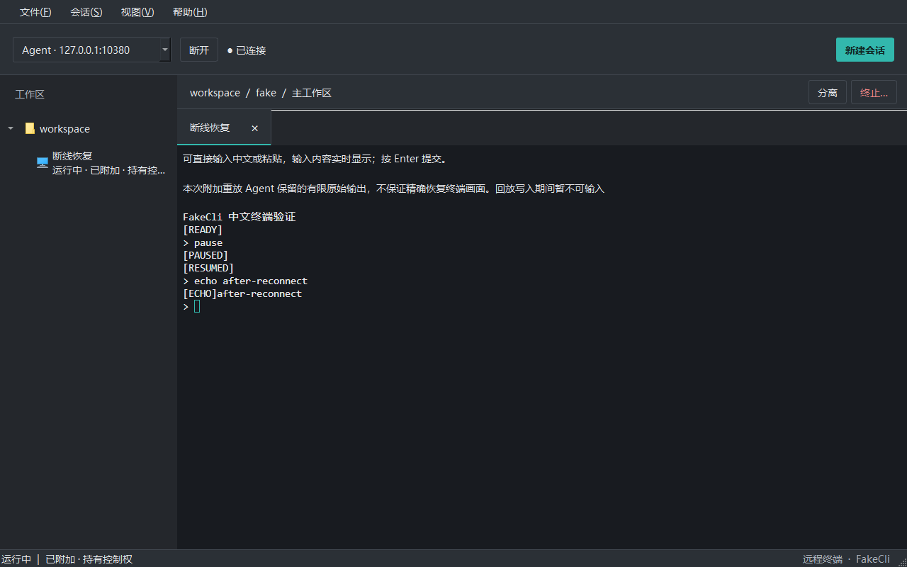

# M5-01 断线恢复与有限历史

## 使用范围

基于 M4-02 提交 `2cc5747`，本任务实现同一 Agent 生命周期内的显式重连和重新附加。用户点击“连接”重新查询会话，再从工作区打开原会话。不会自动建立连接、重放输入、重启进程或抢占其他客户端写权。本卡不含 SQLite、重启状态迁移与日志；后续实现见 [M5-02](M5-02_会话持久化与运行诊断.md)。M5-01 已提交为 `c9aba16`。

## 人工验收

1. 按 [本机启动说明](M4-02_远程终端集成.md) 启动 Agent 和 Client，新建会话。
2. 输入普通中文确认实时可见、退格可用；输入 `pause` 并回车，等待 `[PAUSED]`。
3. 点击 Client 的“断开”，保留 Agent，等待一分钟。**不要关闭 Agent，关闭它会结束进程。** 真实双机断网可单独验证，不需要为了本机验收修改网卡配置。
4. 点击“连接”，从工作区打开原会话。应仍为同一会话，能够看到保留的 `[RESUMED]` 输出；输入新内容应正常响应。
5. 会话页面保留“有限原始输出、不保证精确恢复画面”说明；若历史超过 Agent 缓存，还会明确提示先前内容不可恢复。此提示不会因为刷新列表或操作其他会话而消失。

连接失败时可重试“连接”；未附加前输入不可发送。关闭 Client 后也可以重新启动并按上述顺序附加。同一个连接里的只读冲突仍沿用既有行为，不强制夺取控制权。

## 源码导航

下列路径以仓库根目录为基准。

| 文件与符号 | 职责 |
| --- | --- |
| `core/session/SessionManager.cpp`：`State::append`、`attach`、`takeOutput` | 复用稳定会话、有界历史、每订阅游标；默认每会话保留 1 MiB 原始输出 |
| `core/transport/AgentWebSocketServer.cpp`：`scheduleOutput`、`drainOutput` | 既有 `terminal.overrun` 和绝对字节序号；连接关闭只分离 |
| `core/transport/WebSocketAgentClient.cpp`：`State::receive`、`receiveBinary`、`attach` | 校验初次历史截断、后续序号连续性及会话权限状态 |
| `core/client/IAgentClient.h`：`ClientSession::historyNotice`、`outputReceived` | 客户端恢复提示字段，显示状态；协议边界字段见下文 |
| `apps/RemoteClient/controllers/ClientController.cpp` | 断线清空待输出、尺寸请求和终端就绪标志；保留待输出的历史前缀长度 |
| `apps/RemoteClient/ui/ClientWindow.cpp`：`showSession`、`updateContext` | 显示离线和历史限制；旧页标记 `needsReplay`，重新附加重建视图 |
| `apps/RemoteClient/terminal/TerminalView.cpp` 与 `frontend/terminal/client-terminal.js` | 按历史边界分批，等待 ACK；回放时禁用输入和查询回复，实时查询仍正常响应 |
| `tests/integration/WebSocketAgentClientTests.cpp` | 超限历史重附加、继续输入、提示保留及非法截断通知 |
| `tests/integration/RemoteTerminalTests.cpp`：`reconnectAfterOneMinute` | 真实窗口、WebSocket 和 ConPTY 的一分钟中断与恢复 |

## 行为与边界

每次附加从 Agent 保留的历史开头重放，不使用 `last_ack_sequence` 增量恢复。若首字节前收到一次合法 `terminal.overrun`，客户端记录截断起点并展示不可恢复提示；随后输出必须从声明的偏移开始。重复通知、其他会话通知、无附加通知、偏移矛盾或未声明的首帧缺口都会拒绝。

输出已经开始后再遇到缺口，仍断开并要求重新附加，不把两段不连续的 VT 输出拼接。输出持续快于客户端消费时可能再次超限，应等待输出缓和后重新附加。既有队列上限继续生效。

断线后旧页面只用于查看；即便其 WebEngine 加载回调晚到，也不能把新连接的输出当作旧页面已经就绪。重新附加会重建页面并重放保留历史。原始历史可能从 UTF-8 字符或 VT 指令中间开始，也可能包含历史尺寸下的全屏重绘，因此不能保证画面精确重建。未新增终端快照、后台日志、磁盘输出或依赖。`session.attached.replay_end_sequence` 标记历史结束的绝对字节偏移；跨界帧的历史前缀逐字节标注并贯穿 Controller 缓冲与终端批处理。历史写入期间禁用用户输入及所有终端自动回复，确认渲染后恢复，避免历史查询回复进入活进程。实时查询仍可回复。Client/Agent 必须配套更新，旧版不匹配会拒绝附加，不自动降级。

## 自动验证记录

旧实现上 `retainedTailRemainsWritable` 因超限后附加失败而变红；`client.reconnect` 实际经过一分钟中断后在缺少历史提示控件处失败。真实恢复还复现了历史 DA 查询回复污染当前命令的问题，新增回放边界后修复。Release 全套构建及 CTest **30/30 通过**（154.83 秒），其中一分钟恢复用例 62.40 秒。最后的提示文案调整后已再次增量构建 Release 目标。Debug 配套构建完成，8 组相关 CTest 全部通过（179.69 秒），其中一分钟恢复用例 73.92 秒。修改的 C++ 文件通过 clang-format 检查，终端 JavaScript 通过语法检查；构建启用了 /W4、/WX 和 /analyze。

`client.reconnect` 只关闭测试服务器监听和连接，SessionManager 与真实子进程始终存活；一分钟期间 FakeCli 从 `[PAUSED]` 运行至 `[RESUMED]`，恢复相同地址后验证同 SessionId、只创建一个后端、离线输入不重放、终端不重复追加历史及恢复输入。它是本机回环故障注入，不能替代家庭 Tailscale 实测。

决策见 [ADR-020](ADR/020_有限历史断线恢复.md)。人工输入法候选窗、长时间输出压力、家庭双机和 Agent 重启恢复仍未在本卡验收。

实际 Debug 恢复画面（本机自动化验收）：

